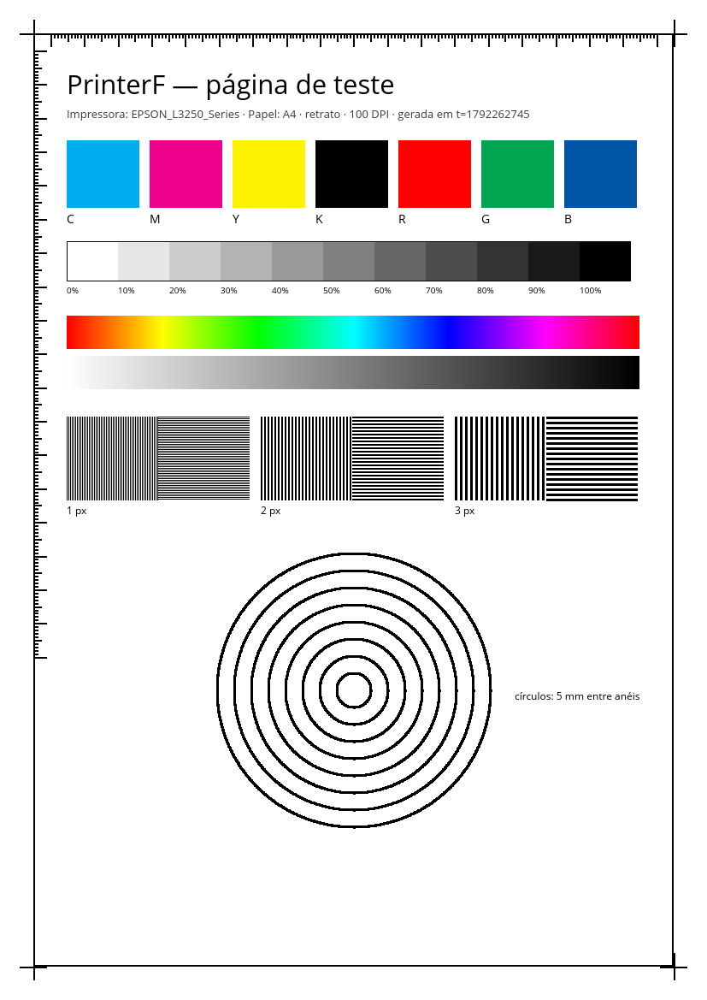

# Guia de uso

```
┌ Arquivo  Editar  Impressora  Exibir  Ajuda ─────────────────────────────────────┐
├──────────────────┬───────────────────────────────────────────┬──────────────────┤
│ Ajuste livre     │ [ foto.jpg + 3 imagens × ][ relatorio.pdf × ] │ Impressora ▾     │
│ Layout           │                                           │ Status           │
│ Papel            │            preview da folha               │ Fila             │
│ Envio direto     │     (clique · arraste · roda do mouse)    │                  │
│ ┌──────────────┐ │                                           │                  │
│ │ Imprimir…    │ │  ◀ Folha 1 de 2 ▶                          │                  │
│ │ Enviar direto│ │                                           │                  │
└─┴──────────────┴─┴───────────────────────────────────────────┴──────────────────┘
```

## Abrir
- **Arquivo → Abrir…** (Ctrl+O): PDF, PNG, JPEG, WebP, `.txt`. **Várias imagens de uma
  vez viram uma única aba**, uma imagem por “página” — prontas para N-up.
- **Arquivo → Adicionar imagens à aba…** (Ctrl+Shift+O): junta mais fotos à aba atual.
- **Arquivo → Foto aleatória…** (Ctrl+R): diálogo com opções do [picsum.photos](https://picsum.photos)
  — todas opcionais:

  | Opção | Valores |
  |---|---|
  | Tamanho | Pequena (~8×5 cm) · **Média (~15×10 cm, padrão)** · Grande (~25×17 cm) · Página inteira · Personalizada (px) |
  | Formato | Paisagem · Retrato · Quadrada |
  | Quantidade | 1–16 fotos diferentes (vêm em N-up) |
  | Preto e branco, Desfoque, Foto específica (ID) | opcionais |

  Com uma aba de imagens aberta, as fotos são adicionadas a ela.
- **Arquivo → Página de teste** (Ctrl+T): página de diagnóstico gerada localmente.

  

  | Bloco | O que observar |
  |---|---|
  | C M Y K | Cada tanque uniforme, sem faixas brancas (bico entupido → limpeza da Epson). |
  | Rampa 0–100 % | Os 11 passos distinguíveis. |
  | Gradientes | Sem degraus (*banding*). |
  | Linhas 1/2/3 px | Contínuas e separadas. |
  | Círculos | Redondos — elipse indica escala errada. |
  | Régua em mm | Com **Escala → Tamanho original**, confira com uma régua física. |

Cada documento abre numa **aba**; feche com × ou Ctrl+W.

## Organizar a folha (painel lateral)
| Seção | Controles |
|---|---|
| **Layout** | Por folha: 1, 2, 4, 6, 8, 9, 12, 16 · Escala: ajustar / preencher / tamanho original · Rotação · **Repetir cada imagem na folha** (folha de fotos) |
| **Papel** | A4 ou Carta · retrato ou paisagem |
| **Envio direto** | Intervalo (`1-3, 5, 8`, `10-`, `-3`), cópias, bandeja, frente e verso, PDF vetorial |

### Ajuste livre (cortar e redimensionar)
1. **Clique** numa imagem do preview — ela ganha um contorno azul.
2. **Arraste** para mover dentro da célula.
3. **Roda do mouse** (ou Ctrl+= / Ctrl+-) para aumentar/diminuir (10 %–400 %).
4. No painel, **Corte esquerda/direita/topo/base** (até 45 % por borda).
5. **Centralizar**, **Redefinir** (Ctrl+0) ou **Concluir** (Esc).

O ajuste vale por imagem e vai para a impressão exatamente como no preview.
**Editar → Redefinir todos os ajustes** limpa todas as imagens da aba.

## Imprimir (rodapé do painel)
- **Imprimir…** (Ctrl+P) — abre o **diálogo de impressão do sistema**: escolha
  impressora, cópias, frente e verso. O PrinterF recompõe as folhas com o papel e a
  orientação escolhidos e entrega ao sistema, que usa o driver certo.
  Evite “páginas por folha” no diálogo se já usou N-up no app (os dois se somam).
- **Enviar direto para …** (Ctrl+Shift+P) — envia à impressora escolhida em
  **Impressora** (menu ou painel da direita), com as opções de “Envio direto”.

## Status e fila (painel da direita, Exibir → Painel de status)
Atualiza a cada 2 s: estado (pronta, ocupada, sem papel, tinta baixa, offline,
pausada), níveis de tinta quando a impressora informa e a fila com a posição de cada
job (⏹ cancela).

Impressoras marcadas **(rede)** foram só descobertas na rede (DNS-SD): o CUPS cria a
fila na hora de imprimir, então o status aparece depois da primeira impressão. Prefira
a entrada sem “(rede)” quando houver as duas ([ADR 0010](../decisions/0010-destinos-descobertos.md)).

## Atalhos
Ajuda → Atalhos de teclado mostra a lista completa (Ctrl+O, Ctrl+R, Ctrl+T, Ctrl+P,
Ctrl+[ / Ctrl+], Ctrl+= / Ctrl+-, Ctrl+0, PageUp/PageDown, F5, F9, Ctrl+W, F1).
